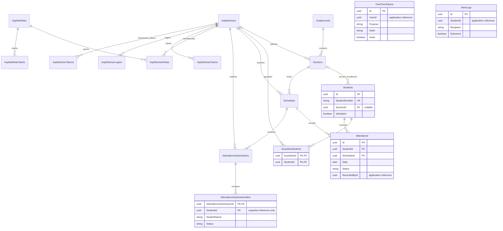

# Talaan — Attendance Management Information System

**System documentation · Updated 14 October 2026**

This guide describes the implementation inspected in the project workspace, including recent local application changes. Application changes are published separately from this documentation update; a branch's application code may differ until those changes are committed.

[Project repository](https://github.com/LowProgram1/Talaan-Attendance-Management-System) · [Documentation website](https://lowprogram1.github.io/Talaan-Attendance-Management-System/)

## Contents

1. [Introduction and problem statement](#introduction-and-problem-statement)
2. [Objectives and target users](#objectives-and-target-users)
3. [System features and technology stack](#system-features-and-technology-stack)
4. [Database structure, relational entity model, and schema](#database-structure-relational-entity-model-and-schema)
5. [Conclusion](#conclusion)
6. [Future improvements](#future-improvements)
7. [References and credits](#references-and-credits)

## Introduction and problem statement

### Introduction

Talaan is an Attendance Management Information System designed to support teachers' everyday work and improve communication between schools and families. It brings class lists, schedules, attendance entries, and summaries into one workspace. Teachers can record whether a student is present, absent, late, or excused, while parents and guardians receive email updates about their children's recorded attendance.

Organized records help school personnel follow up on attendance concerns without searching through scattered notes. Students benefit from clearer records and more timely support. Administrators support this work by organizing classes, managing staff access, and reviewing school attendance information.

### Problems addressed

1. **Scattered and repetitive recordkeeping.** Paper lists and separate files make teachers repeat work and spend time finding the correct class or student record.
2. **Duplicate or inconsistent student lists.** Registering a student in different lists can make it unclear which grade and section the student belongs to.
3. **Delayed communication with families.** Parents and guardians may learn about absences or lateness too late to discuss the situation with their child and the school.
4. **Time-consuming attendance summaries.** Manually counting attendance makes patterns across days, weeks, and months harder to review.
5. **Unclear corrections and responsibility.** Staff need to know what was submitted and why earlier attendance records were corrected.

These are problems the project is intended to address. Measured reductions in workload or improvements in attendance require evaluation in school use and are not claimed here.

## Objectives and target users

### General objective

Provide an organized, usable attendance workspace that helps teachers maintain dependable records, supports students through timely follow-up, and keeps parents and guardians informed.

### Specific objectives

| Problem | Objective | Current supporting capability |
| --- | --- | --- |
| Repetitive recordkeeping | Reduce repeated entry and make class records easier to find. | Central student directory, class rosters, search, and CSV import. |
| Inconsistent lists | Maintain recognizable student records and clear current enrollment. | Generated school ID numbers, duplicate checks, enrollment status, and controlled transfers. |
| Delayed communication | Notify guardians when attendance is first recorded or meaningfully changed. | Emails containing student, subject, date, status, and excused reason where applicable. |
| Slow summaries | Make attendance totals and patterns easier to review. | Dashboard charts, day/week/month reports, and CSV export. |
| Unclear corrections | Retain submission history and identify corrections. | Numbered snapshots, submitting staff identity, and reasons for past-day corrections. |

### Target users and current access

| Target user | Role and benefit | Current access |
| --- | --- | --- |
| Teachers | Maintain attendance, enroll students into permitted sections, and review assigned reports. | Direct staff sign-in. Attendance submission is restricted to the teacher assigned to the schedule. |
| Students | Have attendance recorded consistently and receive support informed by those records. | Student records only; no student sign-in or dashboard. |
| Parents/guardians | Receive updates and discuss attendance concerns with their child and the school. | Linked email contacts; no guardian sign-in or dashboard yet. |

**Administrative support:** administrators manage academic setup, staff accounts, student records/transfers, school-wide reports, and notification logs. This operational role supports the three target groups above.

The database supports multiple children per guardian and multiple guardian links per student. Current add/edit forms work with a guardian name and email rather than a comprehensive multiple-guardian management screen.

## System features and technology stack

### Account access and password management

- **Staff access:** active, confirmed Administrator and Teacher accounts sign in with email/password. Remember-me controls session persistence; sign-out ends the session. Guardian contacts cannot sign in.
- **Invitations and activation:** administrators invite Teachers or Administrators. A single-use activation link allows an initial password to be set and expires after 48 hours.
- **Forgot password:** eligible staff receive a single-use reset link valid for 30 minutes. The reset page provides labeled New password and Confirm password fields, independent show/hide buttons, matching feedback, and a strength meter. Expired/used links are rejected.
- **Signed-in password change:** Settings uses a separate six-digit email code, expiring after 10 minutes with at most five attempts. This is distinct from the forgot-password link workflow.
- **Password requirements:** at least 12 characters, upper/lowercase letters, a digit, and a non-alphanumeric character. Application checks also reject several common password fragments. Five failed sign-in attempts trigger a 15-minute lockout.
- **Profile settings:** staff update their display name; their login email is read-only in Settings. Administrators can request a test notification.

Identity cookies are HttpOnly, SameSite=Lax, and configured with SecurePolicy=SameAsRequest. Role policies restrict access; configured origins control CORS, and write requests with an Origin header are checked against the allowed origins. These controls are not a claim of a complete security audit.

### Dashboard and analytics

- **Role-specific cards:** administrators see school totals; teachers see assigned students, guardians, and subjects.
- **Today's Classes and quick actions:** schedules are filtered by the current weekday in Asia/Manila. Schedules without a weekday appear every day. Quick actions open academic setup or class records.
- **School Community chart:** a doughnut-style chart summarizes the available student, teacher, and guardian counts for the current role.
- **Teachers by Subject:** distinct teacher IDs are grouped by subject text from active schedules. Subject changes appear when data is loaded again. A teacher teaching several subjects appears in multiple slices, so the total represents subject assignments.
- **Attendance trend:** present/absent lines show seven daily buckets, eight weekly buckets, or twelve monthly buckets. Charts use saved records and do not have a live push channel.

**Interpretation limits:** Present Today and Absent Today count attendance records, so one student can contribute once per recorded subject. The administrator's student total includes non-archived unassigned records despite the current “Students Enrolled” label. “Alerts Sent” counts all alert logs, including failed attempts. The Alerts module provides delivery status. These current label limitations are recorded here rather than silently reinterpreted.

### Academic setup and scheduling

Administrators create/edit grades, departments, sections, rooms, advisers, and schedules. Each schedule associates a section, teacher, subject name, start/end time, and optional weekday. Time ordering and overlapping active schedules for the same teacher or section are validated, including weekdays.

Schedules with attendance history cannot have their identifying details rewritten; archive them and create a replacement. Archive/restore controls preserve used academic records. Delete routes may permanently remove unused academic records while archiving dependent/used records. Restoring schedules checks parent availability and conflicts.

The demonstration factory includes Grades 1–6 and example subjects. These are sample-data choices, not fixed model restrictions. Subject names are stored on schedules; there is no separate subject catalog.

### Student List and enrollment

- **Directory:** name/school-number search, grade/status filters, row numbering, and pagination help staff locate students. School ID No., name, grade, section, status, and permitted actions are visible. Internal UUIDs are hidden in Student List and Attendance tables.
- **Creation:** staff enter student and guardian details; a student can remain unassigned until enrollment. School numbers are generated as `STD-0000001`.
- **Duplicate checks:** normalized first name, last name, and guardian email are compared school-wide, including archived/unassigned records. This is a matching rule, not proof of identity; different guardian emails may require manual review.
- **Attendance enrollment:** “From Student List” shows active unassigned students only. Direct student creation remains available. Teachers can enroll into sections they advise or have active teaching assignments in.
- **Transfers:** administrators explicitly move the existing record to another section, retaining its number. Expected current enrollment prevents stale transfer requests from overwriting newer enrollment.
- **Maintenance/history:** administrators edit, archive, and restore records. Relevant historical attendance remains available after transfers; submission snapshots retain captured names and numbers.

The staff-wide directory exposes limited identity/enrollment information without guardian contacts. Contact-bearing lists and enrollment operations have additional section/role checks.

### CSV batch import

Student List and Attendance share drag-and-drop/browse upload, file details, replacement/removal, UTF-8 template download, a paginated preview, and an **Import** button. The browser permits one `.csv` file up to 1,000,000 bytes; the API limits CSV text to 1,000,000 characters.

Required columns, in order:

```csv
firstName,lastName,sectionId,guardianName,guardianEmail
```

Student List has a destination selector searchable by grade, section name, or section ID. The selected section prefills the template and supplies blank section cells. Without a selected destination, each row must provide an authorized active section ID. Attendance fixes the destination to the current class and rejects conflicting section IDs.

Preview flags invalid names, email, section access, and matching duplicates. Commit revalidates and imports valid rows individually, reporting imported, invalid, and failed counts. It is not an all-or-nothing operation or an enrollment-transfer tool. XLSX uploads and multiline quoted CSV fields are not supported by the line-based parser.

### Attendance recording and history

Staff navigate from grade to section to class records. Each roster member receives Present, Absent, Late, or Excused; Excused requires a reason of up to 500 characters. The complete roster is submitted together.

The school day uses **Asia/Manila**. Teachers submit only for the current day; administrators can correct past dates with a reason. Future dates are rejected. Schedule weekdays drive dashboard filtering and overlap validation, but the write endpoint does not separately enforce that an attendance date matches the schedule weekday.

Accepted submissions update current attendance and create a numbered snapshot containing student details and status counts. Expected revisions reject stale writes; idempotency keys prevent duplicate submissions on retries. Transactions and unique indexes support these rules. Snapshots are retained by application behavior, not a tamper-proof database configuration.

The table fills its card and scrolls horizontally on narrow screens. The displayed attendance rate is `(Present + Excused) / all recorded or selected statuses × 100`; Late is excluded from the numerator. Unsaved selections default to Present and must be submitted before they become records.

### Guardian notifications and alert monitoring

After attendance is saved, emails are attempted for linked guardians on first entry or a changed status/excused reason. Messages name the student, subject, date, and status; Excused includes its reason. Unchanged attendance does not send another status notice.

An alert log records each recipient attempt. “Delivered” means the SMTP send operation succeeded, not proof of inbox arrival or opening. Attendance remains saved if sending fails. The email service retries DNS-resolution failures up to twice after the first attempt; there is no durable delivery queue or general redelivery system.

Administrators see the latest 100 alert records with pagination. Forgot-password send failures return a retry message rather than claiming success. Real delivery requires an operational SMTP service.

### Reports and exports

Reports offer grade/section selection and Day, Week, or Month periods; weeks run Monday–Sunday. Rows summarize student/subject status counts and attendance rates. CSV export includes the entire loaded report, not just the visible page. Teachers receive assigned-schedule data; administrators have broader access.

Additional endpoints expose monthly schedule reports and submission history/detail. The main Reports UI emphasizes period summaries; a dedicated complete revision-history interface is not verified.

### User management and interface

Administrators search staff/contact records, filter staff roles, invite staff, and edit permitted account details. Guardian child counts reflect non-archived students. Accounts needed by students, academic assignments, or attendance history cannot be deleted. Administrators cannot delete themselves or change their own email/role through user management.

The interface includes a fixed sidebar with branding/profile, a top bar that remains visible while scrolling, responsive layouts, and loading/error/empty states. Module tables have row numbers and pagination, normally 20 records per page; import previews use 10. Charts use CSS/SVG rather than a charting dependency.

### Implementation boundaries

| Capability | Status |
| --- | --- |
| Staff portal, academic setup, student directory, attendance, reports, CSV import/export, email workflows | Implemented in the inspected workspace. |
| Guardian/student self-service dashboards | Proposed; guardian records are contacts and no student login role exists. |
| Grading and Online Enrollment integrations | Proposed; no external client, mapping, synchronization job, or API contract is implemented here. |
| Served OpenAPI document or Swagger UI | The OpenAPI package is installed, but no registration/mapping is configured in `Program.cs`. |
| Subject catalog, school-year enrollment history, mobile app, offline synchronization | Not implemented. |
| Guaranteed/queued email delivery | Not implemented; attendance notifications use synchronous SMTP attempts after persistence. |
| Date-of-birth management | Database field exists; current forms/import do not collect it. |

### Technology stack

Versions reflect project manifests/container definitions, not assumptions about the latest releases.

| Technology | Framework/library | Purpose |
| --- | --- | --- |
| C# / .NET 10 | ASP.NET Core Minimal APIs (`net10.0`) | HTTP routes, hosting, dependency injection, and authorization. |
| Authentication | ASP.NET Core Identity EF stores 10.0.0 | Accounts, roles, hashes, sessions, lockout, and password operations. |
| .NET data access | Entity Framework Core; Design 10.0.0 | Mapping and schema migrations. |
| PostgreSQL connectivity | Npgsql.EntityFrameworkCore.PostgreSQL 10.0.0 | EF PostgreSQL provider. |
| Database | PostgreSQL 17 (`postgres:17-alpine`) | Records, constraints, transactions, and student-number sequence. |
| JavaScript web framework | Next.js 16.3.8, App Router / Turbopack | Frontend routing/build and same-origin API rewrite. |
| UI library | React / React DOM 19.2.8 | Interactive components, forms, tables, and state. |
| Typed frontend language | TypeScript 5.x | Frontend types. |
| Styling | Tailwind CSS 4.x, `@tailwindcss/postcss`, custom CSS | Utility processing, layouts, charts, and responsive styling. |
| Icons | Lucide React (`^1.51.0`) | Navigation, action, and password-field icons. |
| Runtime/tooling | Node.js 24 Alpine, npm | Frontend build/server; `npm ci` consumes the lockfile. |
| Email | .NET `System.Net.Mail.SmtpClient` | SMTP delivery with configurable TLS. |
| Containers | Docker / Docker Compose | Application services, networking, and persistent volumes. |
| Local mail preview | Mailpit (`axllent/mailpit:latest`) | Optional local SMTP inbox; must be selected in mail configuration. |
| Optional sharing | Cloudflare Tunnel (`cloudflare/cloudflared:latest`) | Opt-in Compose profile for temporary HTTPS access. |
| Backend testing | xUnit 2.9.3, Microsoft.NET.Test.Sdk 17.14.1, EF InMemory 10.0.0, coverlet.collector 6.0.4 | Existing test/coverage tooling; in-memory tests do not reproduce all PostgreSQL behavior. |
| Frontend checks | ESLint 9.x, eslint-config-next 16.3.8 | Declared lint tooling. |
| API description dependency | Microsoft.AspNetCore.OpenApi 10.0.12 | Installed but not configured as a served API reference. |
| Documentation | GitHub Pages, Jekyll, Kramdown, jekyll-seo-tag | Existing Markdown website with custom HTML layout. |
| Diagrams | Mermaid 11 | Documentation ER rendering in the website. |
| Version control / assistance | Git, GitHub, OpenAI Codex | History, publication, and AI-assisted development; Codex is not a runtime dependency. |

### Runtime and configuration

The application and GitHub Pages documentation are separate deployments. Pages hosts this static guide, not the API/database. For local use, create an ignored `.env` from `.env.example`, configure the database, initial administrator, and email settings, then run:

```sh
docker compose up -d --build
```

- Application: `http://localhost:3000`
- Same-origin health response: `http://localhost:3000/api/health`
- Direct development API: `http://localhost:5080`
- Mailpit inbox, when selected as SMTP host: `http://localhost:8025`

The Compose build uses `/api` for browser API calls; Next.js rewrites requests to the backend. Activation/reset links prefer `PUBLIC_FRONTEND_URL`, then `FRONTEND_URL`, then localhost. Use `http://localhost:3000` for local links; these must be opened on the computer running the application.

Startup applies migrations and creates configured roles and an initial administrator if absent. Changing initial-admin environment values does not change an existing password. Database records and data-protection keys use named volumes. Explicit `--seed-demo-data` mode supplies example teachers, guardian contacts, elementary sections, students, and schedules; normal startup does not rerun it. Sample data is not verified real-person data.

The optional `tunnel` profile permits temporary sharing with corresponding frontend URL/origin configuration. No real credentials, production hostname, or external-system API specifications are published here.

For documentation maintenance, edit `DOCUMENTATION.md` and run `python docs/build_site.py` to regenerate `docs/index.md`. The existing Jekyll configuration and layout render the site; `DOCUMENTATIONS.md` preserves the old filename as a link to this guide.

### API route overview

These are internal route families, not a completed partner integration specification. Authentication and endpoint validation apply.

| Route family | Operations |
| --- | --- |
| `/api/auth` | Login/logout/session, profile, activation, forgot/reset, signed-in password-code request/confirm, administrator email test, staff create/edit/delete. |
| `/api/grades`, `/api/sections`, `/api/schedules` | Lists; administrator create/edit/delete-or-archive/restore. |
| `/api/student-directory` | Minimal directory with search, grade/status filters, and pagination. |
| `/api/students` | Scoped lists, create, administrator edit/archive/restore, and `/{id}/enrollment`. |
| `/api/students/import/preview`, `/api/students/import/commit` | CSV validation/import. |
| `/api/attendance/{scheduleId}` | Read roster/revision; submit batch. |
| `/api/dashboard`, `/api/dashboard/trend` | Totals and period trends. |
| `/api/reports`, `/api/reports/summary` | Monthly schedule reports and date-range section summaries. |
| `/api/reports/submissions`, `/api/reports/submissions/{id}` | Submission history/snapshots. |
| `/api/users`, `/api/alerts` | Administrator user/contact list and recent notification logs. |
| `/api/health` | Public process response, not a comprehensive dependency-health check. |

## Database structure, relational entity model, and schema

### Storage model

`AppDb` extends `IdentityDbContext<AppUser, IdentityRole<Guid>, Guid>`. This section follows `Models.cs`, the migrations, and `AppDbModelSnapshot.cs` under `backend/AMIS.API/`. Most entity keys use UUIDs; association tables use composite keys. Dates use PostgreSQL `date`, schedule times use `time without time zone`, and event timestamps use `timestamp with time zone`. Status enums are stored as text; nullable schedule weekday is an integer in storage and an enum string in JSON.

Actual mappings include `AppUser` → `AspNetUsers`, `AttendanceRecord` → `Attendance`, and the singular table `AttendanceSubmissionItem`. There are no separate Teacher, Guardian, Subject, or Enrollment tables.

### Operational schema overview

`PK` = primary key; `FK` = database-enforced foreign key; `?` = nullable. A field ending in `Id` is not automatically an FK.

| Table | Purpose | Important fields and keys |
| --- | --- | --- |
| `AspNetUsers` | Staff accounts and guardian contacts. | `Id uuid PK`; `FullName text`; `IsActive boolean`; Identity email, username, confirmation, password-hash, lockout, and security-stamp fields. |
| `GradeLevels` | Grade/department labels. | `Id uuid PK`; `Name text UNIQUE`; `Department text`; `IsArchived boolean`. |
| `Sections` | Class grouping. | `Id uuid PK`; `Name text`; `GradeLevelId uuid FK`; `Room text`; `AdviserId uuid? FK`; `IsArchived boolean`. |
| `Students` | Student identity/current enrollment. | `Id uuid PK`; `StudentNumber text UNIQUE`; first/last names; nullable middle name/suffix; `DateOfBirth date`; `SectionId uuid? FK`; `IsDeleted boolean`. |
| `GuardianStudents` | Guardian–student association. | Composite PK (`GuardianId`, `StudentId`); both UUID FKs to users/students. |
| `Schedules` | Subject/time/teacher assignment. | `Id uuid PK`; `SectionId uuid FK`; `TeacherId uuid FK`; `Subject text`; `StartsAt`, `EndsAt time`; `DayOfWeek integer?`; `IsArchived boolean`. |
| `Attendance` | Latest student/schedule/date status. | `Id uuid PK`; `StudentId uuid FK`; `ScheduleId uuid FK`; `Date date`; `Status text`; `ExcuseReason text?`; `RecordedById uuid`; `UpdatedAt timestamptz`. |
| `AttendanceSubmissions` | Versioned submission header. | `Id uuid PK`; `ScheduleId uuid FK`; `SubmittedById uuid FK`; `Date date`; `SubmittedAt timestamptz`; `Revision integer`; `IdempotencyKey uuid UNIQUE`; optional correction reason; four status counts. |
| `AttendanceSubmissionItem` | Values captured per student/submission. | Composite PK (`AttendanceSubmissionId`, `StudentId`); only `AttendanceSubmissionId` is an FK. Student number/name, guardian names, status, and optional excuse reason. |
| `OneTimeTokens` | Activation, reset-link, and password-change tokens. | `Id uuid PK`; `UserId uuid`; `Purpose`, `Hash text`; `ExpiresAt timestamptz`; `Attempts integer`; `Used boolean`. Token hashes, not raw tokens, are stored. |
| `AlertLogs` | Recipient notification attempts. | `Id uuid PK`; `StudentId uuid`; `Recipient`, `Status text`; `Delivered boolean`; `CreatedAt timestamptz`. |

**References without FKs:** `Attendance.RecordedById`, `AttendanceSubmissionItem.StudentId`, `OneTimeTokens.UserId`, and `AlertLogs.StudentId` are application references without declared foreign keys in the snapshot. They are not drawn as enforced relationships. Alert logs have no schedule or attendance-date FK and are not a full notification-payload archive.

### Identity and migration tables

| Table | Keys and relationships | Purpose |
| --- | --- | --- |
| `AspNetRoles` | `Id uuid PK`; unique normalized role name. | Administrator, Teacher, Guardian roles. |
| `AspNetUserRoles` | Composite PK (`UserId`, `RoleId`), both FKs. | Many-to-many role membership. |
| `AspNetUserClaims` | `Id integer PK`; `UserId FK`. | Identity user claims. |
| `AspNetRoleClaims` | `Id integer PK`; `RoleId FK`. | Identity role claims. |
| `AspNetUserLogins` | Composite PK (`LoginProvider`, `ProviderKey`); `UserId FK`. | Framework external-login storage; social sign-in is not thereby enabled. |
| `AspNetUserTokens` | Composite PK (`UserId`, `LoginProvider`, `Name`); `UserId FK`. | Framework tokens, separate from `OneTimeTokens`. |
| `__EFMigrationsHistory` | `MigrationId` PK; `ProductVersion`. | EF-managed schema migration tracking. |

### Relationships and cardinality

- One grade has zero or more sections; each section has exactly one grade.
- A user can advise multiple sections; each section has zero or one adviser.
- A section can contain multiple students; each student has zero or one current section.
- Users/students have a many-to-many guardian association through `GuardianStudents`.
- Each schedule has one section and one teacher user; sections/users may have multiple schedules.
- Each attendance row has one student and one schedule.
- Each submission has one schedule and one submitting user, and zero or more items at database level. The API creates populated roster snapshots.
- Identity membership is many-to-many through `AspNetUserRoles`; claims/logins/framework tokens belong to their declared user or role parent.

Teacher/adviser/guardian FKs all point to `AspNetUsers`. Role meaning is checked by application logic, not separate role-specific tables.

### Entity relationship diagram

Only enforced FKs are shown. Token/log entities are intentionally disconnected; their identifier references are explained above.



### Constraints and integrity rules

- Unique indexes enforce grade name, school number, attendance (`StudentId`, `ScheduleId`, `Date`), submission (`ScheduleId`, `Date`, `Revision`), and submission idempotency key.
- Composite PKs prevent duplicate guardian/student links and duplicate student items within a submission.
- Identity normalized username and role name have unique indexes. Unique email is required by Identity validation; its normalized-email database index is **not unique**.
- `OneTimeTokens` has a non-unique (`UserId`, `Purpose`) index; application logic enforces expiry/reuse rules.
- PostgreSQL `student_number_sequence` allocates numbers, with minimum 1 and maximum 9,999,999. Sequence numbers need not be gapless after failed/rolled-back operations.
- Name/email duplicate prevention uses a PostgreSQL advisory transaction lock and application matching, not a unique constraint on student names.
- The student-to-section FK uses `RESTRICT`; the optional adviser FK has default non-cascading behavior. Required relationships generally cascade in the snapshot. Application routes archive used academic records or reject unsafe account deletion to preserve history.
- Overlap checks, role assignments, excuses, date restrictions, and transfer confirmation are API rules, not SQL CHECK constraints.
- There is one nullable current-section field and no school-year/enrollment-history table. Attendance history is not a complete enrollment ledger.

### Migrations reviewed

| Migration | Change |
| --- | --- |
| `20261004040139_InitialCreate` | Initial Identity/domain tables and indexes. |
| `20261004051635_StudentNumberSequence` | Student-number sequence. |
| `20261004055704_AcademicArchiveAttendanceSubmissions` | Academic archive flags and submission snapshots. |
| `20261004063348_NormalizeLegacyStudentIds` | Normalizes legacy numbers and corresponding snapshots. |
| `20261006123544_AttendanceExcuseReason` | Excuse reasons in current attendance and snapshots. |
| `20261013040553_ScheduleWeekday` | Nullable weekday. |
| `20261013093050_StudentDirectoryEnrollment` | Optional student section and restrictive FK deletion. |

## Conclusion

Talaan brings attendance work into a shared, organized process. Teachers find classes, reuse student records, record attendance, and review summaries. Students benefit from consistent records, while families receive attendance information by email. Administrators support the process through academic setup, access management, and review tools.

The system combines enrollment controls, attendance history, reports, and notifications to reduce repetitive work and improve communication. Reliable email, careful data entry, staff training, and evaluation in school use remain necessary to achieve those expected benefits.

## Future improvements

All items below are **proposed**, not completed integrations or installed functionality.

| Enhancement | Purpose and high-level approach |
| --- | --- |
| Grading System integration through its available API | Connect with the existing Grading System identified by the project owner. Agree on student identity mapping, authorization, permitted data, ownership, and synchronization. API availability is owner-reported; its documentation/contract was not supplied or verified in this repository. |
| Online Enrollment System integration through its available API | Reuse approved enrollment records to reduce encoding. Review identity mapping, enrollment changes, reconciliation, and conflict handling with that system's maintainers. No external endpoints, payloads, or credentials are assumed. |
| Parent/guardian dashboard | Authenticated access to linked children, per-child attendance history, and relevant notices. Establish guardian-child authorization and recovery; existing contact records alone do not provide this portal. |
| Mobile application integration | Provide a mobile client using appropriately secured API workflows and device-friendly notifications. Offline capture needs defined synchronization/conflict rules. |
| School-year/enrollment history | Add terms/year periods and enrollment history for promotion, transfer, and historical class membership. |
| Reliable notification delivery | Introduce a durable queue/outbox, retry policy, diagnostics, and preferences. Distinguish submitted, SMTP-accepted, failed, and provider-confirmed delivery. |
| Usability/accessibility | Evaluate keyboard use, focus, contrast, screen readers, touch targets, and chart alternatives with users. Consider Filipino/local-language support. |
| Data quality/imports | Add reviewed XLSX import, robust CSV parsing, guardian-link management, and administrator-assisted duplicate reconciliation. |
| Performance/operations | Profile larger-school queries, extend server pagination where needed, and add dependency health checks, backup/restore procedures, monitoring, and integration/load coverage. |
| API readiness | Publish a versioned API contract and define external-client authentication, scopes, audit records, and synchronization safeguards. Internal routes are a starting point, not a completed integration platform. |
| Analytics clarity | Distinguish unique people from subject attendance counts, successful sends from attempts, and assigned students from unassigned records. |

## References and credits

### Project evidence

This revision was checked against backend models/routes, migrations, frontend components, and configuration. The old `DOCUMENTATIONS.md` filename now points to this guide.

- Backend: `Models.cs`, `Program.cs`, `Auth.cs`, `Academics.cs`, `Students.cs`, `Attendance.cs`, `School.cs`, `Import.cs`, `DemoDataFactory.cs`, and migrations under `backend/AMIS.API/`.
- Frontend: `frontend/src/app/`, password components/helpers, `package.json`, lockfile, `next.config.ts`, `postcss.config.mjs`, and CSS.
- Infrastructure/tools: application Dockerfiles, `docker-compose.yml`, `.env.example`, and `backend/AMIS.Tests/AMIS.Tests.csproj`.
- Website: `docs/index.md`, `docs/_config.yml`, and `docs/_layouts/default.html`.

### Official documentation

These official references support understanding and maintaining verified dependencies/tools. They do not establish that project code was copied from each source or that each was consulted during original development.

| Resource | Relevance |
| --- | --- |
| [ASP.NET Core documentation](https://learn.microsoft.com/en-us/aspnet/core/?view=aspnetcore-10.0) | Backend framework. |
| [Introduction to Identity on ASP.NET Core](https://learn.microsoft.com/en-us/aspnet/core/security/authentication/identity?view=aspnetcore-10.0) | Accounts and roles. |
| [Entity Framework Core documentation](https://learn.microsoft.com/en-us/ef/core/) | Mapping/migrations. |
| [Npgsql EF Core provider](https://www.npgsql.org/efcore/) | PostgreSQL EF integration. |
| [PostgreSQL 17 documentation](https://www.postgresql.org/docs/17/) | Types, constraints, and transactions. |
| [SmtpClient class](https://learn.microsoft.com/en-us/dotnet/api/system.net.mail.smtpclient?view=net-10.0) | Current SMTP transport. |
| [Docker Compose documentation](https://docs.docker.com/compose/) | Container configuration. |
| [Next.js documentation](https://nextjs.org/docs) | Frontend framework. |
| [React Quick Start](https://react.dev/learn) | Component development. |
| [TypeScript documentation](https://www.typescriptlang.org/docs/) | Frontend types. |
| [Tailwind CSS — Installing with PostCSS](https://tailwindcss.com/docs/installation/using-postcss) | Configured styling integration. |
| [Lucide React guide](https://lucide.dev/guide/react) | Icons. |
| [Node.js documentation](https://nodejs.org/api/) and [npm ci](https://docs.npmjs.com/cli/v11/commands/npm-ci) | Runtime and dependency installation. |
| [ESLint documentation](https://eslint.org/docs/latest/) | Lint tooling. |
| [xUnit.net](https://xunit.net/) and [Coverlet project](https://github.com/coverlet-coverage/coverlet) | Tests and coverage. |
| [Mailpit documentation](https://mailpit.axllent.org/docs/) | Local mail inspection. |
| [Cloudflare Quick Tunnels](https://developers.cloudflare.com/tunnel/get-started/quick-tunnels/) | Optional sharing. |
| [GitHub Pages documentation](https://docs.github.com/en/pages) and [Jekyll documentation](https://jekyllrb.com/docs/) | Website publication. |
| [Kramdown documentation](https://kramdown.gettalong.org/documentation.html) and [Jekyll SEO Tag](https://github.com/jekyll/jekyll-seo-tag) | Markdown and configured plugin. |
| [Mermaid ER diagrams](https://mermaid.js.org/syntax/entityRelationshipDiagram.html) | Database diagram notation. |
| [Git documentation](https://git-scm.com/doc) | Version control. |
| [OpenAI Codex](https://openai.com/codex/) | AI development assistant. |

### Credits and provenance

Credit belongs to the project owner/contributors for requirements, implementation decisions, direction, and review, and to the maintainers of the open-source tools used. **OpenAI Codex** assisted with implementation, debugging, interface revisions, and documentation under the project owner's direction. AI assistance is not a substitute for validation and is not an attendance decision-making feature.

No complete historical record of external code searches or copied snippets was found. This guide does not invent tutorial authors, copied-code sources, or consultation history. Screenshots under `docs/module-screenshots/` are historical artifacts and may show earlier interfaces; they do not establish current workflow test coverage. This documentation revision does not claim new application test results.
